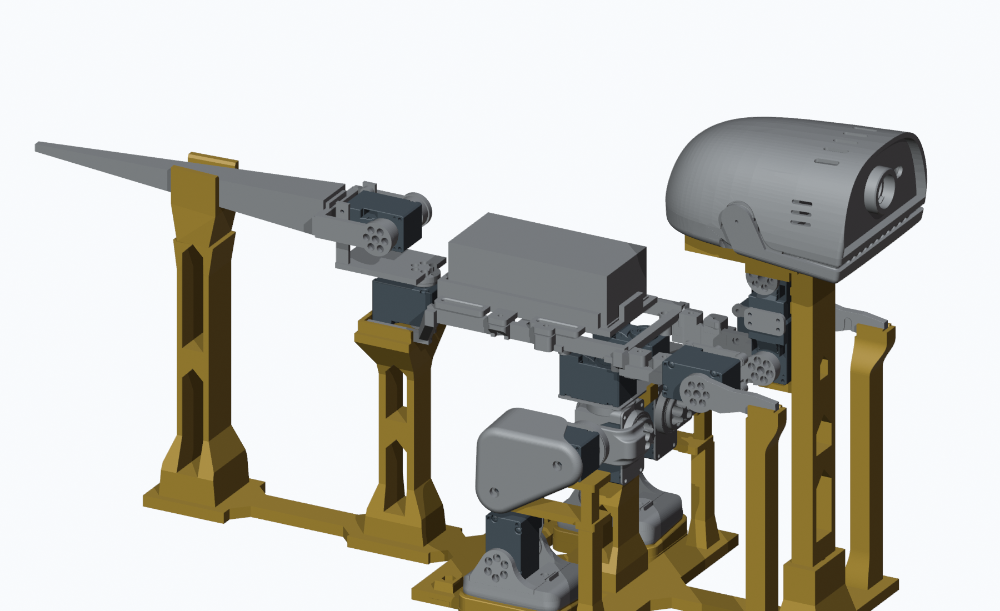
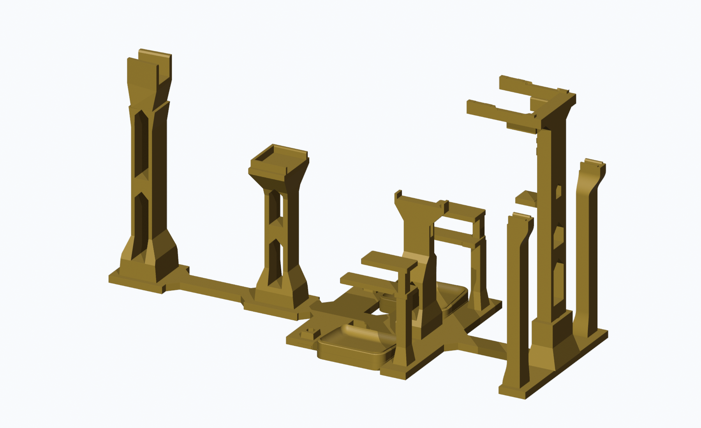
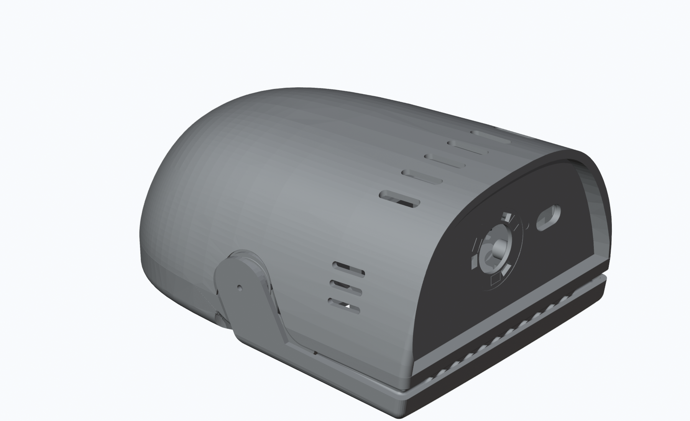
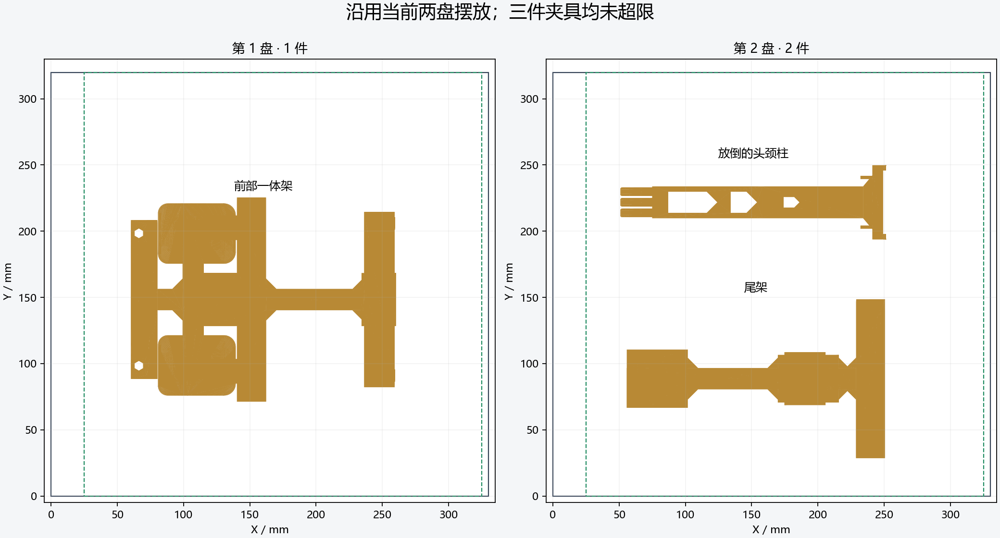

# 整机零位校准架

2026-11-08 最新交付。适用于 MicroDinosaur **OS-M02 开源头腿分支**；三件夹具、两盘打印。机器人为姿态和接触关系的参考模型，夹具与参考整机分别标识。



| 文件 | 用途 |
| --- | --- |
| [WholeBodyFixture_TwoPlates.3mf](WholeBodyFixture_TwoPlates.3mf) | Bambu Studio 原生两盘打印工程。第1盘前部一体架；第2盘尾架＋放倒的头颈柱。包含工艺、耗材和两处手根局部填充修改器 |
| [WholeBodyZeroJig.blend](WholeBodyZeroJig.blend) | 完整装配：140个机器人参考网格＋3件夹具；毫米单位。可在 Blender 中查看和编辑网格 |
| [WholeBodyFixture_Assembly.3mf](WholeBodyFixture_Assembly.3mf) | 同一装配的3MF查看文件，143网格作为一个装配组，已标记不打印 |
| [BodyStand.stl](BodyStand.stl) · [HeadNeckColumn.stl](HeadNeckColumn.stl) · [TailStand.stl](TailStand.stl) | 三件夹具的毫米STL；不携带打印工艺 |
| [Print_Body_Module.3mf](Print_Body_Module.3mf) · [Print_Tail_Module.3mf](Print_Tail_Module.3mf) | 几何交换文件。当前盘位和工艺以两盘原生工程为准 |

## 当前结构

前架包含双脚贴形曲面座、两层水平腿托、髋部前后限位栏及双手槽托。尾架分别支承尾根最低骨架与尾梁：尾根三面围住骨架；尾梁底层为整片4mm斜板。底板采用中间连接与三角加固，手柱外侧平顺过渡。下层腿托自由段宽14mm，脚座边缘已加厚倒钝。

头颈柱单独放倒打印，以三角分布的三枚六角插脚装入前架；插深24mm、槽深24.4mm，插脚/孔对边5.6/6.0mm。两块主底座之间也有六角定位插接。颈部与尾根两侧名义间隙约0.1mm，实际松紧需要试装。



装配参考已同步11月8日最新头壳：顶部6条、左右各3条长圆通孔，侧槽按实物照片前移/下移；头壳三处M2安装导孔为Ø1.8mm。这里的头壳属于整机参考，不属于本包三件夹具的打印内容。本次发布只增加零位架交付包，仓库父目录的主机器人CAD与八盘打印工程保持原字节；两者来源状态在本包清单中单独记录。



## 打印与验证

三件均未超出两盘工程的可打印区域。当前设置为大件15%填充、手根局部50%、4圈墙、0.2mm层高，保留原自动支撑工艺。

| 切片估算（含支撑） | 时间 | 耗材 |
| --- | --- | --- |
| 第1盘：前架 | 17小时27分 | 190.2g |
| 第2盘：尾架＋头颈柱 | 11小时51分 | 142.2g |
| 合计 | 29小时18分 | 332.4g |

两盘原生切片成功、无警告。按零件统计，尾架整体支撑挤出为0；第2盘的支撑来自放倒的头颈柱。估算与本包原生工程哈希绑定，换打印机或工艺后需重新切片。



三件夹具为闭合单实体。20处承托区各81点检查，CAD接触误差小于0.0001mm；颈部及尾根的侧向定位名义间隙约0.1000mm。装配保存重开核对143个网格。详细尺寸见 [design_parameters.json](design_parameters.json)，最终检查范围与工件哈希见 [validation.json](validation.json) 和 [manifest.json](manifest.json)。

**当前为试装原型，尚未完成实物配合、承载及整机装入验收。** 空夹具的定位插接离散路径检查通过；带一体腿托/颈托的整机需要配合关节装入。旧的刚性水平装入与直接下放路径仍有表面穿越，不能直接按整机刚体下放。机器人嘴部沿用已确认的首次牙齿接触姿态，不表示所有齿面同时贴合。

本次仅上传文件，未连接打印机或发送打印。来源与许可沿用仓库 [NOTICE](../../NOTICE.md)。

## 获取文件

Blender和3MF通过仓库现有Git LFS保存。在仓库根目录运行：

```sh
git lfs pull
python scripts/verify_current.py
```

若直接下载ZIP，需确认大文件已包含实际内容，而不是LFS指针。打开原生打印工程时按实际设备、喷嘴、材料重新核对配置。
