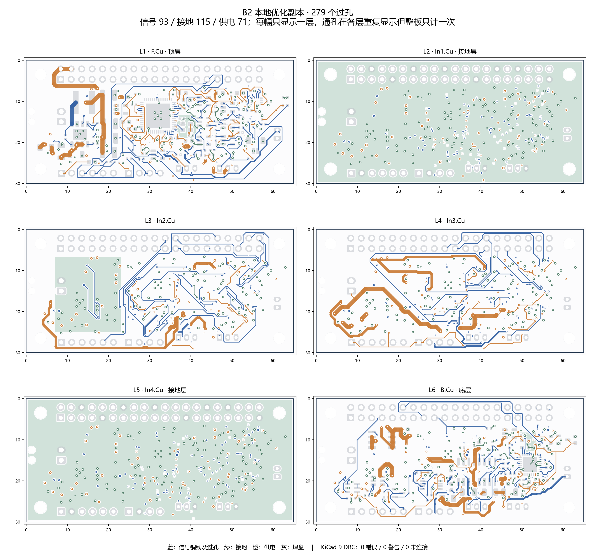

# 当前头部集成板

最新候选：**B2 V3 / 2026-11-07**。65×30 mm，六层，279 个过孔、3938 段走线。KiCad 9.0.9 原生 DRC 为 0 错误、0 警告、0 未连接。当前为设计审阅候选，尚未实物打样与制造放行。

打开 [kicad/HEAD_A0.kicad_pro](kicad/HEAD_A0.kicad_pro)。工程内部文件名沿用 HEAD_A0，不代表这是早期 A0 版本；本目录只包含这一份最新候选。符号与封装库使用 `${KIPRJMOD}` 相对引用，已随工程保存。[BOM](BOM.csv) 对应保留的 B2 器件布置。

功能包括降压与电源保护、音频、板载头部 IMU、FT2232H 双 UART 与两路 S288 半双工接口，并保留身体 IMU、ToF 接口。独立串口与协议适配代码见 [software](software/README.md)。FT2232H 自带 USB/UART，不需要烧写宇树 STM32 示例。

最终 [DRC](validation/final_drc.json) 与 [几何汇总](validation/summary.json) 绑定 PCB SHA256 `566901eef7e306b5e4f0bd7f48aab18467615563099a4b934d516693c2ad7f8a`。115 个接地过孔与 71 个供电过孔保留；USB 差分对和有源 MEMS 时钟铜线保留。检测到的同层共线重复段为 0；这是局部 CAD 检查结果，不是信号完整性或实物性能结论。

本版未完成实板时钟、USB 阻抗、EMI、最大电流/温升或整机装配验证。Radxa 的 USB GPIO 引出需要核对并执行相应硬件电阻选择，当前不是即插即用连接。S288 整串动力仍需电池分组注电，PH 接口和支路保险不等于整腿堵转电流承载能力。本包不提供旧 B2 的 Gerber，避免与当前走线混用；投板前须以本版原生工程完成电气与制造复核。

来源与许可见 [NOTICE](NOTICE.md) 和 [LICENSE](LICENSE)。
