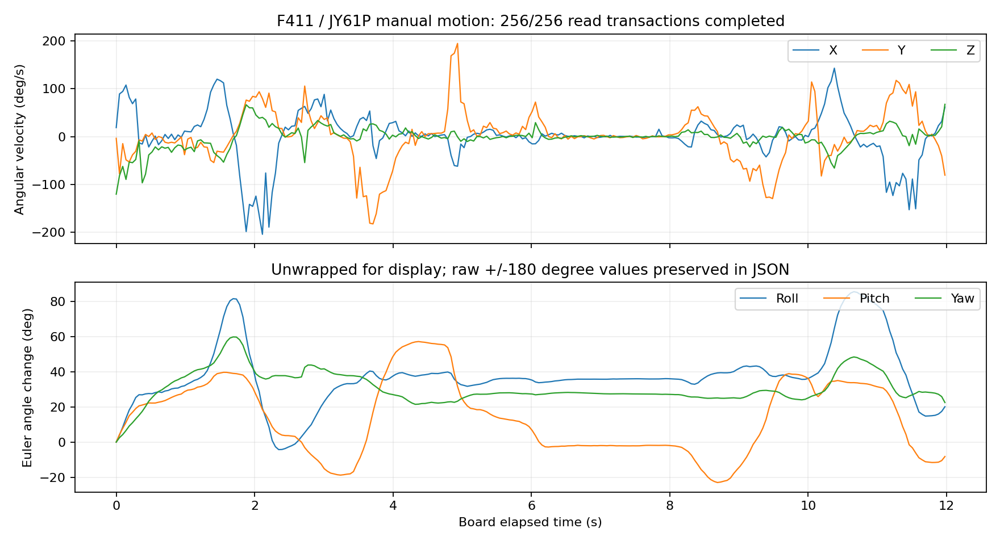

# 当前 IMU 读取与台架数据

测试日期 2026-11-05。F411 与 ZERO 3W 均已完成 JY61P 的基础读取；地址为 7 位 `0x50`。测试没有修改 IMU 地址、标定或持久配置。

| 链路 | 接线 | 已测结果 |
| --- | --- | --- |
| F411 | SDA→PB9，SCL→PB8，VCC→3V3，GND→GND | 临时内部弱上拉、5 µs 软件等待：静置 214/214、手动动作 256/256 事务成功 |
| ZERO 3W | SDA→物理 27，SCL→28，GND→6，VCC→1/3V3 | 启用 I2C4 后约 5 秒 250/250 次成功，加速度模长中位数 0.99724 g |

ZERO 3W 的物理 27/28 在此测试中用于 I2C4；新 HAT 的 USB 引出方案复用了这对引脚，两者属于不同硬件配置，不能同时照抄接线。HAT 的主机改焊/接线应另按其设计复核。

两路均出现约 ±15.6°/s 的候选跳点，F411 提高读取速度后仍有个别异常。跨寄存器更新读取是候选原因，尚未用逻辑分析仪排除电气边沿问题。读取成功不等于精度、帧一致性、安装外参或闭环稳定验收；轮询速率也不等于内部采样率。内部弱上拉只用于短线诊断，正式连接需检查外部上拉与实际电平。

当前数据为 [F411 静置](f411/measurements/stationary_v3_fast.json)、[F411 动作](f411/measurements/motion_v3.json)、[ZERO 3W 读取](zero3w/measurements/connection.json)，全部原始异常点保留。



## 程序范围

`zero3w/probe.py` 使用 Python 标准库，只读既定 I2C4/0x50，最长 30 秒，拒绝覆盖已有输出。已在板上启用 I2C4 的前提下，可运行：

```sh
python3 zero3w/probe.py --seconds 5 --out connection_new.json
```

`f411/probe.py` 是现有 bench v3 固件的主机程序，依赖 `f411/requirements.txt`；`f411/firmware/app.c` 保存当前台架应用源。主机通过显式命令临时改变读取时序/弱上拉，退出恢复默认参数。本包不含完整 STM32 HAL/USB SDK、编译工具链、下载器和可直接烧写镜像，不能仅凭这份 C 文件完成固件构建。固件移植需保留原 WeAct 下载器的前 16 KiB 区域，并核对 USB CDC、时钟和链接地址。

协议字段沿用 [WIT 标准 SDK](https://github.com/WITMOTION/WitStandardProtocol_JY901)：加速度 ×16/32768 g、角速度 ×2000/32768 °/s、姿态角 ×180/32768 °。本轮发布没有运行采集或连接设备。
